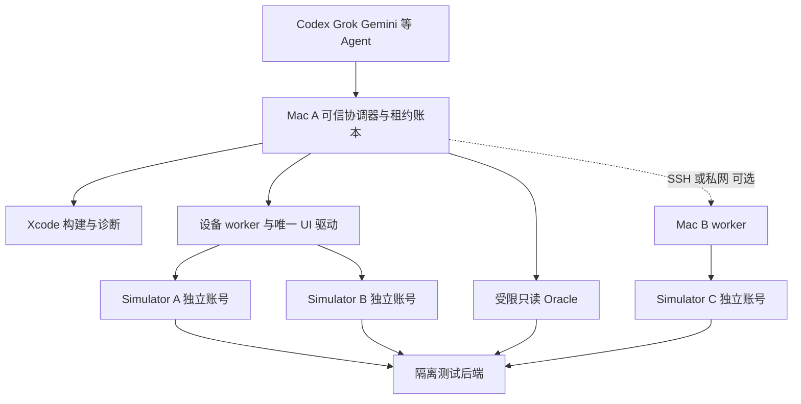

# 城瘾 iOS AI 自动化测试体系实施计划

审查日期：2026 年 10 月 28 日，America/Los_Angeles。对象：Questify 原生 iOS。首期资源：一台 Mac；第二台 Mac 为可选扩展。状态：**只读审查完成，实施尚未开始，原生测试与真实 E2E 本轮均未运行。**

## 1 执行摘要

推荐主方案是 **现有 XCTest / XCUITest + agent-device + 一个项目自有的确定性协调器**。MobileBuildMCP 作为按需构建、日志和诊断入口；日常稳定测试直接调用已有脚本与 Apple CLI。每台设备同一时刻只有一个交互驱动。必要备用是现有 XCUITest 与 simctl，不并装 Maestro、Appium、Mobile MCP 和 Mobilewright。

最快的可验收路径是：确认当前 Mac 环境 → 单模拟器能力探针 → 准入隔离后端与真实测试账号 → 补齐 App 消息自动同步 → 同一构建部署到两个模拟器 → A 发 B 收、B 回 A 收、独立服务端回读、断线补偿和重启历史验证。**第一个跨设备里程碑仍是双账号消息闭环，不能用两个独立页面测试替代。**

当前最大的阻断来自产品装配和合同，而非缺少自动点击工具：普通启动明确 `reviewed:nil`，API/realm 默认空；消息已有 HTTP 发送和历史读取，但接收方聊天页没有自动订阅/同步接线；消息模型没有对端已读回执字段。应先建立合法测试部署与精确能力批准，取得消息事件/补偿/已读合同，再实现缺失链路。不能让测试协调器刷新 B 页面冒充 App 实时接收。

采用四个逻辑角色即可：QA 主控兼 Planner、确定性 Runner、诊断兼受控修复 Agent、独立回归审查 Agent。云端 Agent 并行读代码、编写独立补丁；Mac 上设备操作由主控独占调度。增加 AI 数量不会增加本机可用模拟器容量。

本报告附业务切片台账、当前证据、分阶段任务和完整字段用例。未实现/未核实/未部署项保留在待办分母；不计入已实现模块的真实 E2E 通过分子。未合并候选只作继承入口，不自动计入固定基线。

## 2 现状与事实证据

### 2.1 当前仓库和审查边界

| 项目 | 本次事实 | 对实施的影响 |
|---|---|---|
| 仓库 | `liboyang42-cpu/chengyin-ios`，public，默认分支 `main` | 标准 CI 继续 GitHub-hosted；个人 Mac 不接受任意 PR 自动执行 |
| main | `a8d387e206ed3994b6d265b3618db0c293f6ec15` | 不能把默认分支搜索结果当当前开发代码 |
| 当前开发基线 | `migration/native-ios@76ce1b313af2595f9b7d7ace49040866209c7974`，相对 main ahead 136，behind 0 | 全文源码证据固定此 SHA；实施前重新核对分支并记录差异 |
| 提交时间 | 2026-10-20T18:59:39Z，提交正文包含 `[skip ci]` 及 native NOT_RUN | 本次查询该 SHA 的 Actions runs 返回 0；不宣称此提交 CI 通过 |
| tree | `976c0ccba5d371db2594605237d77612a6f19fbb`，递归树 5314 个条目，未截断 | 已做全树目录盘点与跨域关键链路抽查；未逐一验证全部函数或测试体 |
| 代码体量 | App 804、Core 851 个 Swift 文件；CoreTests 645、AppUnitTests 412、AppUITests 216 个 Swift 文件 | 文件数包含支持代码，不是测试方法数、执行数或覆盖率 |
| 原生目标 | Package.swift：Swift tools 5.9，iOS 17 / macOS 14；Xcode 三层 Core、AppUnit、UI | 复用现有层次，补 live E2E 而非搬迁全部测试 |
| 待合并候选 | open #121 H5；#122/#123 商家 NPC 知识审核重进 | 基线不包含候选；先联系原代码 owner 复核最小接线，避免重复开发 |
| 仓库规则 | 固定 tree 未发现 AGENTS.md，根读取 404；本地 chengyin 根规则已读取 | 遵守只读、生产禁区、公共仓/私密数据边界；本轮不修改任何业务仓库 |

证据：[分支](https://github.com/liboyang42-cpu/chengyin-ios/tree/migration/native-ios)、[固定提交](https://github.com/liboyang42-cpu/chengyin-ios/commit/76ce1b313af2595f9b7d7ace49040866209c7974)、[比较](https://github.com/liboyang42-cpu/chengyin-ios/compare/main...76ce1b313af2595f9b7d7ace49040866209c7974)、[现有工作流](https://github.com/liboyang42-cpu/chengyin-ios/blob/76ce1b313af2595f9b7d7ace49040866209c7974/.github/workflows/native-ios.yml)。本次不能看到其他 Agent 尚未推送的工作区和本日交付包中的未集成改动。

### 2.2 环境实测与用户更新

| 项目 | 会话实测 | 状态与处理 |
|---|---|---|
| Mac A | Apple M5，Mac17,2，10 核，16GB RAM | 已读到；首期目标 1 个构建任务和最多 2 个 UI 设备槽，容量未实测 |
| macOS | 26.6.1，25G76 | 已读到 |
| 当前选中 Xcode | `/Applications/Xcode.app`，26.6，17F113 | 初查及用户更新后复查均如此；不可直接称 Xcode 27 已在本会话生效 |
| Runtime | 磁盘存在 iOS 26.5 runtime；5 个既有设备 plist | 仅静态安装记录；simctl 动态可用性无法确认，不占用这些他人设备 |
| 磁盘 | 初查约 5.0GiB；复查约 3.2GiB 可用 | 与用户“已清理 70GB、升级 Xcode 27”不一致；作为待确认环境身份/生效差异记录，不能据此否定用户更新 |
| CoreSimulator | connection refused / XPC invalid，且日志路径 operation not permitted | 当前受限会话无法访问；不能断言宿主模拟器已损坏；不重启系统服务或绕过权限 |
| Node | v24.15.0 | 达到 agent-device 官方 Node 前置版本；其他原生组件仍须 doctor |
| 设备工具 | PATH 未找到 agent-device、mobilebuildmcp、xcodebuildmcp | 仅说明本会话 PATH，不等于机器任何位置都未安装 |
| SSH / Tailscale | 未获得第二台 Mac 地址与会话；Tailscale CLI failed to load preferences | 不猜测远端主机、不读 SSH 私钥、不自行接管设备 |
| 后端 | 未确认本轮批准的测试部署、账号池和观测权限 | 未登录、未调用 live API、未直接连接数据库；现有代码合同不能证明目标部署可用 |

环境更新后的验收应在**实际运行测试的那台 Mac、同一登录用户**执行以下最小只读探测。命令不切换 Xcode、不清磁盘、不启动业务测试：

```sh
sw_vers
system_profiler SPHardwareDataType -json
df -h /System/Volumes/Data
xcode-select -p
xcodebuild -version
xcrun --sdk iphonesimulator --show-sdk-version
xcrun simctl list runtimes -j
xcrun simctl list devices available -j
vm_stat
memory_pressure
sysctl vm.swapusage
node --version
```

第二台 Mac 若后续接入，先以人工确认的 SSH host alias 执行同一组命令；验证 host key、OS、CPU 架构、工具链、空闲资源和私网连通后才登记。禁止关闭现有任务腾资源。

**资源校准方式**：先一个任务拥有的模拟器，运行 15 分钟代表性导航/聊天/地图，再增加第二个并跑 30 分钟；另测构建与双 UI 重叠时的内存压力和动作延迟。记录峰值 RSS、压力状态、swap 增量、磁盘增量、动作 p95、boot/launch 耗时和崩溃。初始不重叠编译与双 UI；双 UI 合格后再测试重叠。建议 admission 预留至少 4GB 活动工作空间和 15GiB 磁盘安全余量，开始构建前以实际产物峰值加余量计算需求；这些是待校准预算，不是已测容量结论。若内存持续压力、swap 快速增长或关键动作延迟超单设备基线 2 倍，则降至 1 槽，三角色场景等待第二 Mac 或分拆非并发用例，不能把顺序三次登录冒充三端并发。

### 2.3 已有测试和 CI 可复用基础

`tools/current_ci.py` 已根据源码符号依赖选变更相关测试并加入 smoke；未映射/全局改动扩大单元覆盖，保留完整台账。`tools/current_native.py` 已记录 SHA、工具链、模拟器/runtime、真实 XCTest 结果，验证 method union 和不完整执行；UI 使用同次构建的 Products 与 `.xctestrun`，并检查归档 hash、路径和工具链。

当前 `normalized_ui_products`（约 783–796 行）要求 API base URL 为空，专用于隔离 synthetic UI。**live 测试产物必须是另一种明确 profile 和 manifest，不能放宽原检查让真实地址混进离线 UI。** `choose_simulator`（80–91 行）自动挑设备，没有本项目跨驱动租约；在本机并发使用前增加受测 UDID 的显式传入/验证，或提供独立 live worker，禁止多个任务各挑“最后一个设备”。

工作流当前只有 `workflow_dispatch`，不是已经存在 PR 自动触发或夜间 schedule。`max-parallel:20` 是 GitHub 调度上限，不能照搬到 16GB Mac。旧文档中的“六分片”是历史运行图；当前计划由实际选择动态生成。纯 Swift、本机宿主 AppUnit、synthetic UI 和 live E2E 必须分别记账。

现有 `FixtureEnvironmentAssertions.swift` 和 `FailureScreenshot.swift` 可复用环境观察、可访问树诊断和失败截图；真实账号截图/AX 数据需另做隐私处理，不能直接复用仅 synthetic 允许的公开上传策略。CoreSimulator Keychain 的宿主方案已有 `build_simulator_keychain_host.py`，按现有机制复用，不因模拟器签名问题禁用安全存储。另有 8 个明确 physical-device-only 测试声明，在模拟器中仍应为 NOT_RUN。

## 3 业务功能与测试覆盖台账

状态定义：**已实现**指所列独立源码能力完整可定位；**部分实现**指有可达切片但真实装配、写入或业务链未闭合；**未实现**限被审查调用链有明确缺失；**无法核实**指证据不足。所有 live 执行状态本轮均 NOT_RUN。详细调用链和准确测试方法见附录 A–C。

| 域与切片 | 实际代码状态 | 证据入口 | 最先验证的层与业务条件 |
|---|---|---|---|
| A CN 手机号登录、userInfo 回读 | 部分实现 | AuthChannelCoordinator / CNAccountSessionService | Core/AppUnit 账号一致提交；真实渠道、部署、账号池 |
| A Token 恢复、退出 tombstone、scope 隔离 | 已实现客户端规则；live 部分 | KeychainTokenStore、AppSession.restore/logout | 离线与401区别、退出后重启、旧回调不注销新账号 |
| A US Apple/密码等普通登录 | 未形成正常可用渠道 | RegionalConfiguration、RegionalLaunchConfiguration | 禁用路径不发请求；US provider/签名/区域配置另验 |
| B 关注、公开资料、startChat | 部分实现 | SocialActionContracts / SocialMemberActionFactory | follow 显式0/1及回读；不能当双向好友申请 |
| B 会话、历史、分页、文本发送 | 部分实现 | MessagingService、MessageActionCoordinator | message ID/会话归属/opaque cursor/未知发送原ID |
| B 接收方自动接收、断线补偿 | 未实现于当前消息链 | MessagingService:20–21；MessagingHistoryView:149–160 | 阶段2产品前置；禁止 runner 代刷 |
| B 对端送达与已读回执 | 未实现客户端模型；后端无法核实 | MessagingContracts:75–114；IMExpandedService:25–41 | 不以normal/recalled或markRead ACK代替readAt |
| C 队伍读取/邀请上下文 | 部分实现 | TeamReadOnlyService、SessionTeamViews | 读准入、成员/邀请来源、晚到详情失效 |
| C 创建加入退出解散、附近申请 | 部分实现，普通 writer 未挂载 | TeamHTTPService、NearbyTeamHTTPWriteAdapter | 正常工厂目前只读；写批准、回执、余量竞争 |
| D 活动主题浏览、报名、任务 | 部分实现 | TopicService、RegistrationProduction、PlayService | 免费报名→答题→nodes/route-state回读→重启 |
| D 剧情章节与隐藏内容 | 部分实现 | ChapterStoryContracts、JourneyNarrativeContracts | 未解锁内容不进入 UI/AX/缓存；个人/团队范围 |
| E 漫游位置、POI、探索与恢复 | 部分实现 | RoamLiveService、RoamLiveSessionController | 默认dormant；坐标系/accuracy/采样时间、会话原ID |
| F 定向/自由探索分型 | 已实现本地分型 | PlayGameplayMode | 模式值分别验证，不扩称完整玩法 |
| F 高级小游戏与多人命令/回执 | 部分实现 | TemplateAdvancedDraft、PlayAdvancedRuntime、PlayGameSessionRuntime | 12种枚举；CAS、服务端随机/奖励、原request恢复 |
| F 城市大富翁相关棋盘 | 部分实现，只读 | CityPlayerReading；CityPlayerView:84 | game/season/rules/revision一致；占领/掷骰/过路费写未闭合 |
| F 末日寒冬 | 无法核实专属实现 | 当前主题/运行时入口未核实7幕资源/体温合同 | 先取得内容包hash与规则oracle，不能当普通页面套件 |
| F qmod/H5执行 | 元数据部分；执行闭环无法核实 | WorkshopOwnedPackage、InstalledDraftReceipts；候选PR121 | 包元数据≠执行；H5候选响应持有者/壳未接通 |
| G 玩家/商家 AI NPC | 部分实现 | ShopNPCHTTP / ShopNPCCoordinator / MerchantNPC | outcome/requestId/retryable/safety；文本≠任务完成 |
| G NPC 进程内中断恢复 | 已实现本地保护；杀进程部分 | ShopNPCInterruptionTests | 保留原请求；内存pending不能声明跨进程持久化 |
| H 商家资料/CRM/售后/员工/结算 | 部分实现 | MerchantBusinessProduction、MerchantOperations | owner/finance/target精确批准；售后意见≠退款 |
| H 俱乐部成员/排期/出勤/通知治理 | 部分实现 | ClubService、ClubGovernanceProduction | 申请→批准→退出；活动scope、CAS、audience |
| I 简单发布 | 部分实现，普通工厂只读 | AppSession.makePublishingService:1524–1540 | 保存/发布须独立writer+journal，不放开全部能力 |
| I 专业编辑、审核、发布、工坊 | 部分实现 | ProjectEditHTTPService、ApprovedTopicReleasePublicationClient、Workshop* | 章节节点语义回读、冻结版本、license与FREE/PAID隔离 |
| J 订单支付取消退款 | 部分实现 | OrderLifecycleProduction | SDK返回≠支付；报名/支付/退款分维度读回；只用沙箱 |
| J 非现金奖励、券、钱包商品提现 | 部分实现 | NonCashRewardService、CouponManagementRuntime、WalletCommerceService | award唯一性、命令回执、负账目、预览≠支付/出款 |
| K 城市赛季快照恢复 | 已实现本地一致性算法 | CityPlayerReading:170–207 | 409最多完整重读一次，不混旧成员/新赛季 |
| K 完整World→Season→Quest生命周期 | 无法核实 | 确有season及topic/chapter切片 | 先建权威模型/端点映射，不能以章节结构代替 |
| L 生命周期、图像音频、导航、无障碍 | 部分实现 | App生命周期协调器、RetainedImage*、WalkingNavigation*、fixture UI | 后台/取消/大字/深色；真实OS/内存/耗电需实测 |
| L 推送、完整离线能力、性能基线 | 无法核实完整闭环 | 本次树/关键链未取得APNs注册至路由和完整性能证据 | 推送注入≠真实APNs；模拟器趋势≠真机能耗 |
| 补充 内容广场治理、收藏、合作、CN/US合规 | 部分实现 | SquareWorkspaceCoordinator、AccountCollection*、PublisherLifecycle* | 私密内容撤回、举报、账户隔离、区域默认拒绝 |

### 3.1 文档与实现的实质差异

1. `docs/ios-current-status.md` 的“当前”仍固定 10月15日 `7c21af45`；本轮采用实际分支 `76ce1b31`，不沿用旧完成率。
2. README 的“7种高级游戏”概述与当前 `TemplateAdvancedDraft` 的12种case不一致，采用当前枚举；不推导12种均已真实验收。
3. 订单接线文档说22个测试，当前 `OrderLifecycleProductionTests.swift`有31个已写方法；采用源码数，执行状态仍NOT_RUN。
4. 构建复用文档描述历史六分片，当前工作流是动态选组/分片；采用当前脚本，不删历史证据。
5. 工具官网首页宣传 `replay -u` 自动修复，但agent-device版本文档明确该flag是no-op；采用版本合同，选择器修改仍需审查和重跑。
6. 用户更新70GB/Xcode27与本会话观测不一致，保留双方事实并在实施准入时重新核对；不通过修改工具链强行迎合旧文档。

这些差异仅影响描述和执行依据，不解除任何权限、生产、凭证和UNKNOWN写入约束。

## 4 测试层次与风险排序

| 层 | 复用/新增入口 | 核心断言 | 设备与执行频率 |
|---|---|---|---|
| 1 Core单元 | Tests/CoreTests | 状态机、排序游标、scope、金额单位、精确重试 | 无模拟器；每次变更 |
| 2 AppUnit/组件 | Tests/AppUnitTests | 真实组合、Keychain宿主、ViewModel、取消/旧回调 | 一个租借模拟器；按影响 |
| 3 API集成 | 拟新增 Tests/LiveE2E/oracles | 真实身份、字段、持久化/版本、权限负例 | 可不占UI；独占测试数据 |
| 4 单UI | 现有 AppUITests + 新live smoke | 导航、AX语义、正常装配、禁用状态 | 一设备；每个候选构建 |
| 5 多账号E2E | 拟新增 Tests/LiveE2E/scenarios | A写、server读回、B独立收到、重启恢复 | 两设备原子租借；P0 smoke |
| 6 并发竞争 | 同一协调器case | barrier后提交、唯一胜者/版本冲突、最终状态 | 两/三设备；业务合同时可执行 |
| 7 故障恢复 | 组件故障+live transport故障 | timeout未知、重复保护、后台/杀进程、补偿去重 | 单/双设备；每日相关回归 |
| 8 性能稳定 | XCTest metrics/OS日志 | 冷启动、RSS/泄漏趋势、请求数、崩溃和挂起 | 定时稳定设备；真机补测能耗 |

**P0先做**：正常启动/真实身份与退出隔离、消息双端/历史/断线恢复、免费活动报名与任务读回、全部涉及数据串号/未知写入/权限失效的负例、crash/hang。即使组队产品整体暂为P1，越权解散/踢人、订单越权与支付误报仍是P0。

**P1**：队伍加入退出和余量竞争；同局command/receipt；商家俱乐部与玩家；专业草稿/发布/审核；NPC异常与奖励唯一性；城市赛季快照。**P2**：扩展UI/语言/系统尺寸、长时稳定、地图与媒体性能、真机传感器和能耗。寒冬、完整World、未接通H5保留BLOCKED，不用规划用例稀释P0执行成功率。

场景台账按正常、异常、边界、身份、并发、网络、数据一致性、幂等、后台重登和UI/server一致性组织，提供92条首批可分派场景，覆盖A–L及补充治理域。它不是对全部状态组合的穷尽枚举；World/Season/Quest、寒冬等缺少实现/合同的类别保留阻断，阶段5在合同冻结后补齐相应正常、边界、权限、并发与恢复用例。每条字段展开，状态一律计划未运行；具体业务动作和oracle可用后才能晋级READY_LIVE。用例数量不是测试通过数。

## 5 一台 Mac 起步与两台 Mac 扩展架构



首期主控、SQLite租约账本、轻量HTTP读回、agent-device worker均在Mac A；AI推理可在云端。Mac A先构建一次，停止构建重负载后用A/B两个任务专属模拟器执行一个双设备run。第二台Mac不是消息里程碑前置；若实际容量只有1槽，则必须增加已核准第二主机才做真正双端。

云端Agent默认提交声明式任务：exact SHA、case IDs、环境ID、能力需求、允许文件范围、产物hash。可信主控校验后执行，云端不持有个人Mac通用shell、生产凭证或共享设备proxy token。Agent之间可以共享工具协议和已审脚本；不能共享同一未租借的会话或账号。

第二台Mac接入后各有本地worker和loopback proxy；主控经SSH隧道/Tailscale私网连接，设备ID为`hostID+UDID`。主控维护唯一账本，不把SQLite放网络共享盘。Mac B若只运行已编译App和agent-device，不必有完整源码；若执行XCUITest，需匹配工具链、完整Products/.xctestrun和脚本配置；若编译/诊断源码则必须有该SHA的隔离checkout。

构建复用键为 **源码SHA + Xcode build + SDK + CPU架构 + target/configuration + market/realm/profile + dependency lock摘要**。同一组匹配才复用`.app`与测试Products；不同工具链分开建一次，不在不兼容时静默重编译。模拟器arm64产物不能当真机产物，Intel/Apple Silicon之间不得直接混用。运行时OS也写入manifest并验证支持范围；首期两端固定相同runtime，差异矩阵后置。

远程连通只需已批准的控制通路；Agent供应商未必支持Tailscale。若云环境不可入网，改由本地主控向可信队列**出站拉取**任务及上传脱敏结果，不开放公网设备端口。第二Mac链接探测和专用测试账号获准之前，所有远程能力标待验证。

## 6 技术选型与兼容性

| 工具 | SwiftUI与结构读取 | 多设备/远程与回放 | 成本/限制 | 决策 |
|---|---|---|---|---|
| agent-device 0.21.33 | 原生iOS AX snapshot，CLI/MCP/typed Node SDK | session+UDID+claim，proxy，.ad回放；业务协调自建 | Node≥22.12；Xcode27实际兼容性待探针；iOS网络dump只解析日志 | 主设备层 |
| MobileBuildMCP 2.7.1 | Apple构建测试诊断，亦有AXe UI工具 | simulatorId；无已证实两Mac业务调度器 | 与设备工具交互重叠；共享defaults要避免 | 限构建/诊断，按需启用 |
| XCTest/XCUITest/simctl | 原生元素查询、metrics、xcresult、生命周期操作 | destination/UDID，build-for-testing与test-without-building | 现有资产最多；跨账号屏障仍自建 | 必留基础及备用 |
| Maestro 2.12.0 MCP/CLI | 原生AX、YAML、MCP | 多设备/分片有支持；两Mac需包装 | 新维护一套YAML/driver；无本项目既有资产 | 暂不引入 |
| Mobile MCP 1.0.14 | 原生AX/坐标，MCP | device指定；自有两Mac完整租约待验 | 主要探索，与主设备层重叠 | 暂不引入 |
| Mobilewright 0.0.67 | TS locator/自动等待/报告 | worker一设备，pool/shard；一次case多设备仍需协调 | 不能以workers=2证明A/B一条业务；双Mac路径待验 | 暂不替换 |
| Appium/XCUITest driver 12.x | WebDriver、AX、多语言SDK | 多session；唯一UDID、WDA端口、DerivedData；远程HTTP | WDA/driver/server层数多；核心最新精确版未锁定 | 无既有资产，暂不引入 |

上述工具均依赖App实际accessibility语义；地图、Canvas、视频和自定义游戏界面可能只有坐标。第一阶段能力探针必须覆盖聊天输入/发送、导航返回、列表、弹窗与至少一张地图；稳定用例优先accessibilityIdentifier，坐标只作有证据的有限fallback。

agent-device的iOS `network dump`不提供完整网络拦截证明；`settings airplane`当前仅Android。iOS断网应采用每个测试会话独立的relay/transport故障，不关闭Mac网络。标签明确为“真实后端 + 传输故障注入”，物理无线断网另由真机验证。远端daemon拒绝`--save-script`，先在Mac本地录制，远端回放已审脚本。`replay -u`不自动修脚本。

MobileBuildMCP最低macOS14.5/Xcode16+不等于已经验证本项目的Xcode27。用户完成升级后保留当前安装，按doctor和城瘾App能力探针确认，不为本计划另行升级/降级。Xcode原生Agent能力可用于诊断，但先确认实际27接口；不以未经读到的API代替本报告已核实入口。

### 6.1 已核实的安装和探针命令

下列是**下一阶段获准实施后**的命令，本轮未执行。项目化依赖应锁在测试工具package-lock；不修改iOS产品依赖。不同时安装所有候选。

```sh
npm install -g agent-device@0.21.33
agent-device doctor
agent-device devices --platform ios
agent-device capabilities --platform ios --udid "$SIM_A" --json
agent-device open "$APP_BUNDLE_ID" --platform ios --udid "$SIM_A" --session "$RUN_ID-A"
agent-device snapshot -i --session "$RUN_ID-A" --json
agent-device close --session "$RUN_ID-A"

# 构建诊断确有需要时，再启用这一项
npm install -g mobilebuildmcp@2.7.1
mobilebuildmcp-doctor
mobilebuildmcp --help
```

各Agent通过通用stdio MCP启动`agent-device mcp`或`mobilebuildmcp mcp`，不绑定厂商SDK。首期高频执行使用CLI/Node SDK。远程host可用官方`agent-device proxy --port 4310`，默认loopback；token仅从私密配置/环境注入，不写参数。SSH隧道、每host profile、allowlisted UDID/command与主控授权必须同时成立。proxy内部claim不约束绕过它的xcodebuild，因此所有驱动都要遵守外层lease。

官方证据与更详细比较见附录D，版本固定到审查日；将来升级工具应先重跑探针，不自动跟随latest。

## 7 建议项目结构和接口边界

以下是**拟新增的文件范围**，尚未创建基础设施；在iOS仓独立`feature/ios-ai-e2e-foundation`分支实施。已有业务文件保持各owner负责，共享装配由唯一集成owner修改。

```text
qa/
  catalog/modules.json             业务状态、证据SHA、现有测试映射
  catalog/cases.json               本报告场景及READY/BLOCKED状态
  catalog/impact-rules.json        补足现有current_ci到live场景的映射
  schemas/task.schema.json        受约束任务输入
  schemas/result.schema.json      结果与证据必须字段
  config/hosts.example.json       无地址密钥的结构示例
  config/profiles.example.json    synthetic与staging-live明确分离
  runner/leases.ts                host/UDID/account/object原子租约
  runner/coordinator.ts           有序DAG、barrier、deadline、取消
  runner/worker.ts                显式设备、fencing检查、限定动作
  runner/devices/agent-device.ts  唯一UI驱动适配层
  runner/oracles/                 真实只读合同和身份/版本核对
  runner/faults/                  单会话故障与解除记录
  runner/evidence.ts              ndjson、截图、AX、请求与hash
  runner/report.ts                HTML/JSON/JUnit聚合
  tests/                         node:test验证租约/超时/丢事件/重放安全
  package.json / package-lock.json
Tests/LiveE2E/
  scenarios/message-roundtrip.ts
  scenarios/team-membership.ts
  scenarios/activity-registration.ts
  support/identifiers.json        实际审查后的AX标识，不复制全文截图
docs/qa/                           准入、运行手册、故障分类
```

结果、凭证、SQLite、DerivedData、截图和账号池位于仓外任务目录，禁止提交。日常`tools/current_ci.py`/`current_native.py`原入口继续使用；新增live逻辑不导入历史重建工具，不把5MB历史manifest搬进新协调器或每次发给模型。首期直接Node脚本和SQLite足够，不引入Kubernetes、消息队列集群或常驻多Agent微服务。

## 8 多账号多设备同步与失败恢复

### 8.1 资源与会话隔离

每个run原子取得`environment + host/UDID集合 + account集合 + conversation/team/activity/resource集合`，排序后一次申请，资源不足排队；不先占一个设备无限等另一个。每个actor固定UDID、accountID哈希、role、realm、session revision、lease epoch。一个账号默认不能跨独立run共享；同账号双端只在专门测试用例中申请。

SQLite单主控事务管理`FREE → RESERVED → BOOTING → READY → RUNNING → CLEANING → FREE`，异常进入`QUARANTINED`。lease包含owner run、递增fencing token、expiresAt、heartbeat、process身份与能力清单；worker每次变更动作前重新验证。初始建议心跳20秒、资源租约120秒；proxy自身有效期按实测文档另外续约。租约过期先隔离设备/账号，不立刻转给下一run；确认旧native进程停止并完成回读才释放。

模拟器沙盒和Keychain随UDID隔离；每个设备仍用产品真实region/realm/account命名空间。不要为每个run伪造产品realm来抹掉UNKNOWN锁。App卸载不保证Keychain清空；优先产品正常退出，再使用任务所有的专用模拟器重置或经批准的准确namespace清理。重置前先处理pending、日志与证据；绝不清已有他人模拟器/系统Keychain。

### 8.2 有序执行与屏障

一次跨设备case是状态DAG，不是把步骤随机分给Agent。独立启动/登录可以并行；依赖业务提交、接收、已读、奖励结果必须按屏障推进。

| 屏障 | 完成条件 | 初始超时策略 |
|---|---|---|
| ENV_READY | 源码/产物/profile/runtime、真实后端、账号lease均匹配 | 前置失败为BLOCKED/INFRA_ERROR，不发业务写 |
| ACTORS_READY | A/B读取各自authoritative account，账号不同、角色合法、UI同账号 | 60秒上限，登录provider单独限流 |
| RECEIVER_READY | B已进正确会话，自动接收通道确认；记录cursor/版本基线 | 15秒，不能用固定sleep判就绪 |
| MESSAGE_COMMITTED | A发送原clientID，独立oracle读到serverID/会话/发送者/nonce | 15秒暂定；不因timeout再发新ID |
| MESSAGE_OBSERVED | B UI出现同serverID所指内容一次，保持不刷新 | 5秒目标、15秒硬限；记录真实延迟 |
| REPLY_OBSERVED | B新clientID回复，A/server同样确认 | 同上 |
| RECOVERY_COMPLETE | B恢复通道后与server增量ID序列一致且无重复 | 30秒硬限，cursor追赶有上界 |

这些是初始测试预算，不是已承诺的业务SLA。上线SLA需产品与服务合同确定；慢于目标单独报告，超过硬限失败。事件必须绑定run/case/account/conversation/request/leaseEpoch，拒绝旧run与未来/重复屏障事件；时间采用主控monotonic耗时，跨主机墙钟仅辅助，不能拿未定义时区的消息字符串直接计算时延或排序。

等待UI的poll允许查询可访问树；**不得调用刷新动作、消息历史API或改App状态来代替接收方同步**。server oracle在独立测试进程读取，不能把其数据注入B。两端UI serverID不可见时，用测试构建允许的脱敏语义观察将UI行与原模型serverID关联，既不暴露token也不改业务状态；只有文本nonce的证据要注明较弱，不能宣称验证消息ID。

### 8.3 故障及重试

分开记录`PRODUCT_FAIL / CONTRACT_BLOCKED / ENV_BLOCKED / INFRA_ERROR / INCONCLUSIVE / PASS`。只读查询可在deadline内退避；UI动作是否已dispatch未知时先读状态，不能盲点第二次。非幂等写入只遵守原产品协议：original request ID、frozen payload、receipt/status回读。第一阶段每case最多一次基础设施重试，产品失败不自动重跑到绿；恢复性重跑使用新runID并保留首败。

Agent中断时，确定性worker能继续到已批准边界，主控失联则停止新写入、保存日志和pending。设备卡死只终止该run拥有的进程/模拟器；不kill所有Simulator、不重启全局CoreSimulatorService。网络恢复先核对已有提交与游标再续跑。服务端状态未知或清理失败时隔离账号/资源；不得删journal解除锁。

### 8.4 可维护业务矩阵

每个多端场景按`角色组合 × 业务状态 × 传输故障点 × lifecycle × 权限/版本变化 × OS配置`登记。首期只取风险组合，避免笛卡尔积爆炸。消息至少覆盖前台同会话、会话外未读、离线N条补偿、分页重叠、重启历史、发送响应丢失、跨账号晚到响应；组队覆盖owner/member/outsider和最后一席竞争；跨角色先用免费活动；同局玩法先用已经有view/command/receipt合同的游戏，城市占领待实现。

## 9 Agent 分工与受控修复

| 角色 | AI职责 | 确定性职责 | 并发和文件边界 |
|---|---|---|---|
| QA主控兼Planner | 理解diff、更新业务场景、决定风险与派工 | 签入case/expectation hash、资源分配、报告状态机 | 唯一catalog与共享装配owner |
| Runner/Coordinator | 稳定路径无需高成本推理；探索时才用模型 | 设备/账号lease、执行、屏障、oracle、证据、清理 | 单UDID单driver；2槽只支持1条双端case |
| Failure Analyzer兼Fix Agent | 先分基础设施/合同/产品，再最小修复 | 静态分析、编译、定向测试、证据关联 | 独立feature分支、声明文件白名单 |
| 独立Regression/Reviewer | 核对结论、检查越界/回归 | 原验收标准完整重跑、相关场景回归 | 不与Fix Agent共同修改同一文件 |

一个Agent可承担多个逻辑职责；不需要7个常驻高成本会话。首波可用3个云端开发Agent并行处理“runner基础”“消息协议/客户端接线”“数据oracle/证据”，第4个做集成审查；本机仍只有一个构建写者。`AppSession.swift`、`AppCompositionRoot.swift`、`NativeRuntimeDependencies.swift`、`QuestifyApp.swift`、PBX仅由集成owner修改，其他lane提交小补丁并标依赖。

修复门禁：固定失败run与原断言hash → 隔离feature分支 → 最小回归先红后绿 → 编译/相关Core与AppUnit → 原case同合同复测 → 邻近P0回归 → 独立review。AI不能删除测试、降低预期、把fixture替换live、放开生产gate或改授权owner/scope来消除失败。涉及鉴权/RBAC、JWT/Redis、新产品依赖、后端或跨模块变更必须按仓库边界另行确认；本轮只提供任务设计，不授权外仓写入或自动合并。

成本控制：稳定回归模型调用数为0；先用结构化断言、错误码、栈/日志摘要和相关文件diff定位。失败首轮仅给模型最小证据包，截图和完整AX树按需读取；按commit+case+失败签名去重。每失败最多2个修复候选，仍失败转人工/owner；不设无限自愈循环。记录每run模型输入/输出token、工具墙时、构建耗时和首次通过率，不能凭工具宣传给速度排名。

## 10 可观测性 测试数据与安全边界

一次run固定这些字段：`runID, caseID, attempt, caseHash, expectationHash, gitSHA, buildFingerprint, profile, backendDeploymentID, hostID, UDID, runtime, actorHash, role, accountRevision, leaseEpoch, stepID, requestID, clientOperationID, serverEntityID, serverRevision, monotonicTime, outcome`。截图、AX、client日志、网络摘要、oracle读回、crash与xcresult保存路径和SHA256，写入append-only ndjson时间线；修复提交和复测run反向链接原失败。

请求ID优先复用服务器已有字段；HTTP header或trace字段若后端未支持，先记录本地request span并标缺服务端关联，不编造端到端Trace。请求体/响应仅保存allowlist字段与状态/ID/hash，脱敏认证头、手机号、个人地址、聊天正文和媒体URL；测试正文用nonce可公开识别，但仍避免把真实账号资料上传公开Actions。客户端日志不等于服务器日志，UI/API一致也不等于直接验证数据库物理落盘。

最小oracle优先使用已经批准的业务读取：消息历史/会话未读、team/info、activity/registration/info、nodes/route-state、game view/receipt、order双状态、发布status。仍不足时向后端owner提出**仅staging**、短期scoped凭证、runID+resourceID限定、只读状态/版本/持久化事件ID/幂等计数的观察合同；无任意SQL、无生产路由、无伪造身份、无全库导出。部署ID和read-after-write/最终一致窗口写入合同。没有oracle就标BLOCKED_OBSERVABILITY，不能由AI猜截图代替。

账号池至少含玩家A/B/C、商家owner/finance/operator、俱乐部主理人/活动负责人/普通成员、创作者owner/协作者/无权外部人，以及冻结、角色撤销、过期会话等异常身份。允许角色复用同一认证账号的前提是业务模型如此，不能在runner里随意赋角色；所有权来自后端真实userInfo/access。真实登录渠道至少单独完整验一次；后续预置会话如获准，只使用真实staging身份和产品session scope，报告注明SESSION_BOOTSTRAP，不当登录UI覆盖。

种子数据按`环境+runID+caseID`分区，清单登记所建活动、主题、队伍、消息会话、券批次、奖励、订单与版本。初始化通过批准seed/API或独立测试库快照，不能以生产数据库执行脚本。跨run复用账号前检查未决journal和服务端操作；unknown账号隔离。清理先读回确认结果，再按精确ID取消/归档/测试环境TTL清除，最后验证无run私有对象可见、退出guest、释放lease。清理失败本身是run失败的一部分。

支付、退款、提现和出款只用隔离provider sandbox或本地确定性provider适配，分开标注。不得在生产用真实钱验证；provider stub成功不能称真实支付E2E通过。App应只按服务端报名与payment双状态宣布付款完成，商家售后AGREE不能当退款已执行。

保留策略初值：通过run仅manifest/计数/关键屏障摘要保留14天；失败保存必要截图、AX、日志、xcresult与只读oracle最多7天，单run设置总大小上限并保留索引；crash/审计按用户批准政策。公开CI仍保留其当前1天脱敏fixture策略。未启动任何定时任务或远程监控。

## 11 分阶段实施任务与验收

工作量 S=约半天至1个工程日，M=1至2日，L=3至5日；是实现规模估计，不含账号/后端/合同等待，不能相加当交付承诺。共享文件集成串行；表内“并行”只指没有共享文件或资源冲突的任务。

| ID/阶段 | 优先级与任务 | 依赖 | owner与文件范围 | 验证与完成定义 | 规模/并行 |
|---|---|---|---|---|---|
| E00 阶段0 | 确认升级后的Mac身份、Xcode/Runtime、磁盘与权限 | 无 | Env；仓外environment.json | 最小探测命令成功；解释70GB/27差异；不重置全局服务 | S；可并行 |
| E01 阶段0 | 固定实施SHA与候选归属，测试映射和阻断台账 | 无 | Planner；qa/catalog | 每模块有代码证据、ready/block原因、owner；不沿用历史通过数 | S；可并行 |
| E02 阶段0 | 读确认staging登录、IM事件/游标/read回执、清理/观测合同 | 无 | Contract owner；docs/qa/contract-readiness | 无部署/账号则明确阻断；不改后端/生产 | M；可并行 |
| F10 阶段1 | 锁定agent-device并做AX/交互/日志探针 | E00 | Device；qa/config、仓外工具缓存 | 指定UDID，启动真实App、读tree、截图、一次可断言导航；保留doctor | S |
| F11 阶段1 | 单主控lease与任务schema | E01 | Runner；qa/runner/leases、schemas | 两个抢同设备任务仅一成功；过期fencing拒绝旧worker | M；与F10并行 |
| F12 阶段1 | 结果schema与失败证据 | E01 | Evidence；qa/runner/evidence/report | 故意触发失败有截图/AX/时间线；缺证据不能PASS | S；可并行 |
| F13 阶段1 | 一次构建产物manifest与live profile边界 | E00,E01 | Build；qa构建适配；唯一owner修改current_native | exact hash/toolchain验证；synthetic仍拒绝API URL；live无fixture flags | M |
| F14 阶段1 | 本机1→2模拟器容量校准 | F10,F13 | Env；qa容量记录 | 15/30分钟负载数据；稳定槽位数有实测；不占其他设备 | S；独占Mac |
| M20 阶段2 | 测试环境真实认证与精确能力装配 | E02,F13 | Integration；AppCompositionRoot/RegionalLaunchConfiguration/AppSession | 真实userInfo绑定A/B；release默认不放开；负权限0dispatch | M；需明确接线授权 |
| M21 阶段2 | App消息接收与前台/重连补偿 | E02 | Messaging；新接收适配/Coordinator及Core/AppUnit | 产品自身同步；serverID去重/opaque cursor/旧会话拒绝；无test代刷 | L；与runner并行 |
| M22 阶段2 | 消息oracle与单会话故障注入 | E02,F12 | Oracle；qa/runner/oracles/faults | 能区分ACK/持久化/对端可见；B断网不影响A；解除有证据 | M |
| M23 阶段2 | 屏障状态机与双端完整case | F11,F12,M20,M21,M22,F14 | Runner；Tests/LiveE2E/message-roundtrip | 正反向唯一消息、断线N条、顺序去重、重启历史完整 | M |
| M24 阶段2 | 未读与对端已读合同分验 | E02,M23 | Messaging+Oracle；对应客户端模型/测试 | unread合同可验；无远端read字段则显式BLOCKED而不伪造PASS | M；可独立 |
| R30 阶段3 | 可选Mac B探测及私网worker | M23且需要扩容 | Env；qa/config/hosts、worker连接 | host/UDID显式，远程AX与日志；断隧道保留未知结果 | M；非首期前置 |
| R31 阶段3 | 跨主机构建复用/lease验收 | R30,F13 | Runner/Build | 同指纹一次构建；不匹配拒绝；两主机抢同lease失败 | M |
| B40 阶段4 | 队伍普通writer合法挂载与成员同步 | M23,E02 | Team；独立Core/Tests；共享装配交Integration | 建/邀/入/拒/退/解散、owner负例；receipt缺失不盲重试 | L |
| B41 阶段4 | 免费活动发布报名跨角色 | M23,E02 | Business；对应业务适配/LiveE2E | 商家发布权威回读→玩家报名→主理人看同ID；清理完成 | M/L；与B40并行代码 |
| B42 阶段4 | 任务和剧情恢复 | M23,E02 | Gameplay；Play相关独立文件/Tests | answer回执+nodes+重启、两玩家个人/队伍进度隔离 | M |
| B43 阶段4 | 已有game command资源竞争 | B42,明确竞争合同 | Gameplay+Oracle | 最后资源仅合法获益者、版本冲突、原请求恢复、两端收敛 | M；城市占领未实现则阻断 |
| B44 阶段4 | NPC异常与真实任务结果 | B42,E02 | NPC；ShopNPC/测试 | request/outcome/safety/任务进度一致；unknown不换ID；音频另验 | M |
| X50 阶段5 | 扩展H/I/J和补充域矩阵 | B40–44相应就绪 | Domain owners；catalog和独立测试 | 每个已实现切片有正常+关键失败/越权/恢复覆盖；blocked另列 | L；多lane代码并行 |
| X51 阶段5 | 无障碍/语言/OS/媒体与性能基线 | F14,稳定build | Regression；原UI/metrics | CN/US、中文英文、暗色大字；冷启动/内存/请求基线；真机项NOT_RUN | M/L |
| C60 阶段6 | 现有影响选择接live场景+可信本地队列 | M23,E01 | CI；impact-rules、runner入口 | 账号/消息改动必选IM；未映射扩大范围；清单可审查 | M |
| C61 阶段6 | 私有控制面自托管runner可选 | C60,安全隔离批准 | CI/Env；私有控制仓，不改公共CI部署边界 | 只接已审exact SHA；无fork自动执行；取消只清本run | M |
| C62 阶段6 | 受控修复与独立回归 | C60,F12 | Fix+Reviewer；白名单feature分支 | 固定验收hash、失败复现、最小补丁、编译/相关测试/原场景重跑 | M |
| C63 阶段6 | 夜间全量与长稳计划 | C60,稳定率达标 | QA；后续批准的调度配置 | 有资源窗口/预算/保留策略；首败保留；当前不创建schedule | S/M |

### 11.1 各阶段客观验收和回退

| 阶段 | 前置与实际验证入口 | 可量化验收 | 风险与回退 |
|---|---|---|---|
| 0 现状 | E00–02；上述只读命令、git SHA/树、合同checklist | Mac动态inventory成功；每阻断有owner；确定测试部署/账号/清理身份或明确BLOCKED | 环境不可达继续代码工作；不伪造设备容量 |
| 1 单设备 | agent-device doctor/open/snapshot；现有swift/Xcode入口 | 10次独立launch/nav/assert/close循环全过；故意失败有证据；冲突lease拒绝；产物不变 | agent-device不兼容则用既有XCUITest/simctl；不安装多框架试错 |
| 2 双端消息 | 同一build两UDID；拟实现message-roundtrip case | 核心正反向与恢复10轮独立run全过；每轮UI/API/ID一致；0串号/重复/丢消息；3个故障点各至少3轮 | 实时/read合同缺则BLOCKED；保留已完成基础；不得降成手动刷新 |
| 3 双Mac | 私网探测、同manifest双worker | 3轮跨主机双端case；一次断链正确隔离并恢复；构建hash一致 | 回一台Mac2槽，关闭仅任务隧道/worker |
| 4 复杂业务 | B40–44，仅就绪合同场景 | 每条链正常与关键故障至少3轮；一次并发竞争有服务端最终唯一性证据 | 缺业务能力保留BLOCKED；不拿无关fixture补分 |
| 5 全业务矩阵 | 每域实施case映射，ready/boundary状态 | 所有已实现且获准P0都有自动化入口及执行证据；未执行项逐项列原因 | 不追求笼统100%；不可自动化项保留真机手册 |
| 6 持续修复 | 可信队列、选测、审查、report | 一次注入的真实回归完成发现→证据→修复→原case重跑；验收hash未改；原首败可追溯 | 关闭自动修复只留报告；不自动merge或改生产 |

双设备完整目标若包含“对端已读”，M24合同未就绪时阶段2只能签收已完成子项，整阶段保持未完成；不能因为基础收发10轮通过就宣布全部验收通过。性能门槛先用稳定硬件20轮冷启动建立p50/p95及RSS基线，再采用经确认的相对回归预算，例如p95恶化20%触发调查；不能先编造秒数。

### 11.2 验证命令和执行纪律

以下入口已在当前仓库或Apple文档核实，**本轮没有执行**。`BASE_SHA`、`QA_TMP`、`SIM_A`由批准任务manifest提供；不要在脏工作树运行current检查后以删文件方式修绿。

```sh
python3 -B tools/current_ci.py check
python3 -B tools/current_ci.py plan --base "$BASE_SHA" --mode related --output "$QA_TMP/plan.json"
python3 -B -m unittest -v tools.tests.test_current_ci tools.tests.test_current_native
swift test
xcodebuild -project Questify.xcodeproj -scheme Questify \
  -sdk iphonesimulator -destination "platform=iOS Simulator,id=$SIM_A" \
  -derivedDataPath "$QA_TMP/DerivedData" CODE_SIGNING_ALLOWED=NO build-for-testing
xcodebuild test-without-building -xctestrun "$QA_XCTESTRUN" \
  -destination "platform=iOS Simulator,id=$SIM_A" \
  -resultBundlePath "$QA_TMP/result.xcresult"
```

AppUnit继续用现有Keychain宿主构建路径；不能把上述Questify UI scheme误称覆盖所有AppUnit。`current_native.py run`已有严格RUNNER_TEMP、干净源码、start-file及same-run身份要求，应由现有工作流或经审查本地wrapper完整提供，不复制一个缺参数命令宣称可用。拟新增Node runner的命令行schema由F11/M23实现后锁定，报告中的项目接口均属设计，不是当前已存在API。

## 12 最小双账号消息示例设计

### 12.1 真实执行顺序

1. 原子租借A/B设备、真实玩家账号和隔离会话；验证profile为staging-live、无synthetic启动参数、两端build相同、userInfo账号不同。
2. 并行正常启动/登录；A与B进入同一会话；B接收通道就绪后通过ACTORS_READY/RECEIVER_READY。
3. A通过UI发送`runID/caseID/nonce/seq=1`，产品生成并保留client_message_id。独立oracle取得serverMessageID及sender/conversation。
4. B不刷新、不调用测试API注入UI，等待出现同消息一次；检查正文、发送者、serverID和服务端序列。B通过UI回复，A同样验证。
5. 未读阶段让B离开会话但保持App在线，记server未读基线；A发受控k条，验证合同规定的计数变化；B回会话标read后server回读。对端read显示单独依赖read回执合同。
6. 对B的App传输施加隔离故障，A继续发3条；A与服务器仍正常。恢复B，验证补偿ID集合和server顺序，所有ID唯一，无手动刷新。
7. 终止B的App进程，重启并从服务器重新读历史；确认已提交消息持久可见。另一个case专测“发送未决时杀进程”，当前内存pending未闭环应保持阻断。
8. 关闭会话、读取最终状态、清理该run资源、退出账号并归还设备；清理或unknown未决不成功则隔离，不删除证据。

### 12.2 伪代码与真实SDK边界

下面`lease/run/oracle/ui/faults/evidence`均是**拟开发的项目接口**，用于明确业务顺序，不是现成agent-device API，也不是本轮可运行的交付脚本。唯SDK client/open/snapshot/close语法来自官方0.21.33示例。

```ts
import { createAgentDeviceClient } from 'agent-device';

async function messageRoundtrip(spec) { // 项目伪代码
  const lease = await resources.acquireAll(spec, { rejectPartial: true });
  const A = createAgentDeviceClient({ session: `${spec.runID}-A`,
    lockPolicy: 'reject', lockPlatform: 'ios' });
  const B = createAgentDeviceClient({ session: `${spec.runID}-B`,
    lockPolicy: 'reject', lockPlatform: 'ios' });
  try {
    await preflight.requireLiveBuildAndApprovedDeployment(spec);
    await Promise.all([
      A.apps.open({ app: spec.bundleID, platform: 'ios', udid: lease.A.udid }),
      B.apps.open({ app: spec.bundleID, platform: 'ios', udid: lease.B.udid })
    ]);
    await Promise.all([ui.loginNormally(A, lease.A.actor), ui.loginNormally(B, lease.B.actor)]);
    await run.barrier('ACTORS_READY', () => oracle.distinctAccountsMatchUI(A, B));
    await ui.openConversation(A, spec.conversationID);
    await ui.openConversation(B, spec.conversationID);
    await run.barrier('RECEIVER_READY', () => ui.receiverChannelReady(B));

    const intent = await ui.sendTextOnce(A, spec.uniqueText(1));
    const saved = await oracle.waitPersistedByClientID(intent.clientID, { deadlineMs: 15000 });
    await ui.waitMessage(B, saved.id, { deadlineMs: 15000, refresh: false });
    await oracle.assertUIMessage(B, saved);  // serverID/sender/会话/正文各自核对
    const reply = await ui.sendTextOnce(B, spec.uniqueReply(1));
    await assertReplyVisibleOnAAndServer(reply); // 不在未知结果时生成新request重发
    await assertUnreadAndReadContractInSeparatePhase();

    await faults.blockActorTransport(lease.B, { recordAllChanges: true });
    const sent = await sendThreeFromAWithOriginalIDs();
    await faults.restoreActorTransport(lease.B);
    await assertBMatchesServerSequenceWithoutDuplicates(sent);
    await ui.terminateAndRelaunch(B);
    await assertHistoryReadbackFromServer(B, sent);
    await evidence.finishWithOriginalExpectationHash(spec);
  } catch (error) {
    await evidence.captureBothDevicesAndOracle(error);
    throw error;
  } finally {
    await faults.restoreOwnedRulesBestEffort(lease);
    await reconcileOrQuarantineUnknownWrites(lease);
    await Promise.allSettled([A.sessions.close(), B.sessions.close()]);
    await resources.cleanAndReleaseOrQuarantine(lease);
  }
}
```

实现F11/M23时用Node `node:test`验证：barrier乱序/重复/旧epoch、一个参与者超时、设备lease冲突、取消和UNKNOWN写入不可自动重放；再用真正App和staging签收。协调器单元测试通过只能证明调度逻辑，不是消息E2E通过。

## 13 质量指标 持续集成与限制

| 指标 | 分母与口径 | 不能混入的内容 |
|---|---|---|
| 代码覆盖率 | 同SHA编译可插桩的Core/AppUnit源码，分别报line/branch | UI页面数、规划功能、未编译真机代码 |
| 已实现切片覆盖 | 已定位实现且具有批准可测试条件的切片；blocked另报 | 未实现寒冬/完整World等不能算已覆盖 |
| 关键业务场景覆盖 | 冻结P0场景总数及ready/blocked/not-run/pass各数量 | fixture不算live pass，子项不算整链完成 |
| 跨账号流程覆盖 | 明确角色组合与联合oracle的完整链 | 两个各自独立UI测试 |
| 执行成功率 | 首次执行PASS/实际执行case；另报基础设施失败 | 重试最终绿不能抹首败；跳过不算通过 |
| 稳定性 | 同build同环境重复运行的首败率/结果波动 | 新build修复后的通过不能当旧build稳定 |
| 阻断缺陷 | P0/P1产品、合同、环境分别计数及owner/龄期 | 用一个总覆盖百分比掩盖阻断 |

每个候选build先跑现有静态/Core/AppUnit/相关syntheticUI，再运行live smoke。稳定入口的变化触发相关模块；AppSession、鉴权、网络、持久化或全局路由变更扩大回归。失败只定向复测但在修复后必须重跑原完整业务链，不能只验证最后一步。夜间全量需用户批准时间窗口后设置；当前不创建定时任务。

并行规则：纯Core与不占用同对象的只读API可并行；同一构建目录写入、同一设备UI、同一账号/订单/资源、同一后台故障规则串行。双设备case占两个槽，但步骤遵循DAG；不能由GitHub matrix把A/B分成无共享屏障的两个job。一次构建对应多个执行worker，`.app`与Products只读；DerivedData写者唯一、输出目录每run独立。

公开仓继续用GitHub-hosted常规CI。建议本地runner首先作为Mac上的可信出站任务队列；如以后要接GitHub自托管，使用独立私有控制仓/受限runner group、人工或已审精确SHA、最小权限和隔离OS账户，禁用外部fork触发与不可信`pull_request_target` checkout。私有控制面也不使不可信源码安全，编译脚本/宏仍需信任。初期每Mac一个runner服务，服务内部再调度设备槽；label不是资源锁，现有全局构建/设备lease仍必需。不得把个人钥匙串、生产SSH/DB凭证给job。

主要限制：模拟器不能证明GPS真实性、相机/NFC/AR行为、真实APNs端到端、WeChat/Apple支付provider、耗电与热降频、真机锁屏文件保护。可做模拟位置/推送载荷/固定provider的组件和UI测试，但各自标注注入范围。真实iPhone补测放在独立验收台账；unsigned device build不等于真机执行。

本轮事实限制：后端部署与真实账号未访问；第二Mac未连接；当前受限会话不能操作CoreSimulator；Xcode27与70GB更新未能由当前会话确认；所有工具兼容性与容量仍待实测。没有证据宣称“系统搭建完成”“双端通过”或“全业务测试完成”。

## 14 可直接分派的独立 Agent 任务包

统一头指令：只在获准实施后执行。先重新核对`chengyin-ios`当前分支与SHA，阅读实际AGENTS/owner记录；固定输入版本，不整包覆盖候选，不动生产、小程序、Android或未授权外仓；不输出秘密。每包输出commit、文件列表、原命令/结果、NOT_RUN/BLOCKED和证据manifest。不得自行降低验收或解除UNKNOWN锁。

### 包 A 环境与设备探针

执行E00、F10、F14。只写仓外环境记录及`qa/config`无密钥示例；重新确认用户升级的Xcode27与可用70GB在同一执行host生效。若动态simctl仍被当前权限拒绝，记录准确拒绝并在合法宿主会话执行，不绕过权限。获准后仅装锁定agent-device，先一个专属UDID，再测两个。交付doctor、AX/截图/日志、15/30分钟负载与设备槽位结论；不改AppSession/鉴权，不停他人任务。验收按阶段1/容量标准。

### 包 B 确定性协调器

执行F11、F12及M23调度部分；文件仅`qa/schemas`、`qa/runner`、`qa/tests`、LiveE2E message框架。实现原子设备/账号/对象lease、fencing、barrier/DAG、bounded deadline、首败保留、错误分类和finally清理。写有意义的调度测试；模拟worker只证明runner，真实消息验收待包C。验收：两个并发任务不抢同UDID；旧worker不再写；超时/取消保留UNKNOWN；输出完整schema。不得改产品验收为自动刷新。

### 包 C 消息合同与客户端接线

执行E02、M21/M24。先读MessagingService/History/Contracts/MessageAction及当前后端可访问合同，查找事件订阅、认证、游标、去重、补偿、read回执；没有合同先交具体阻断清单，不编造WS地址/API。复用消息模型与原请求ID，补App自身接收与恢复，Core/AppUnit先验证旧账号/会话事件丢弃。修改共享AppSession只提交集成hunk交owner。用户未授权鉴权/后端修改则保持边界。验收：B不刷新接收；DTO准确区分可见/撤回/远端read；未就绪项明确BLOCKED。

### 包 D 测试环境准入与联合断言

执行M20/M22数据合同部分和数据池设计。与后端/部署owner核对隔离origin、deploymentID、账号/角色、seed/cleanup、支付沙箱和只读oracle；未经授权只交合同，不写外仓。复用现有业务读取验证messageID/序列、unread、membership、任务/订单状态；单B故障不得影响A/其他工作。交付无秘密schema、读回断言、清理/隔离流程。真实登录和预置session覆盖分别标记。

### 包 E 构建集成与独立回归

执行F13、C60，担任共享文件唯一owner。接收B/C/D最小补丁，核对新候选PR归属；保留原synthetic API空值检查，新增独立live build身份。对所有worker强制UDID和lease；复用一次Products构建，验证toolchain/hash，再跑原Core/AppUnit/相关UI及双端完整链。审查验收hash未变、没有关闭guard/删测试/公开真实数据。交付可复现报告，合并仍按用户授权与仓库门禁。

首轮A/B/C/D可以并行设计/代码，E串行集成；本机探针与构建/设备执行排队。阶段2通过后再分Team、Gameplay、Business、Creator各独立文件lane，复用同一个协调器和证据协议。

## 附录索引

后附A账号消息组队、B玩法/NPC/赛季、C商家俱乐部发布交易的源码证据与已有测试入口；D官方工具研究与链接；E完整测试场景。附录中的“当前主机26.6”均是观测快照，用户随后更新Xcode27的差异以2.2节为准。所有附录场景仍是计划，未运行。


### 可直接读取的附件

- [账号消息与组队源码审查](source-audit/identity-messaging.md)
- [玩法漫游 NPC 与赛季源码审查](source-audit/gameplay.md)
- [商家俱乐部发布与交易源码审查](source-audit/business.md)
- [官方工具选型证据](source-audit/tools.md)
- [92 条场景 JSON](test-cases.json)
- [审查证据摘要](audit-evidence.json)
